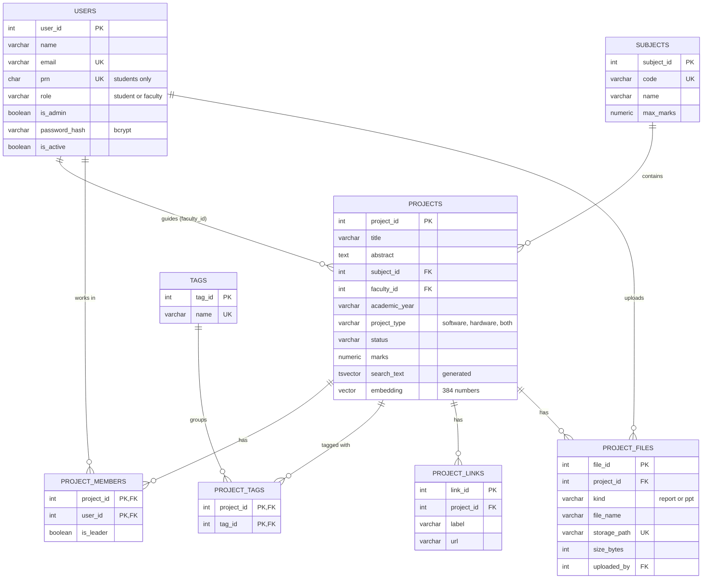

# PBL Tracker

One place for every PBL project a department runs: who is in the team, which faculty
member guides it, which subject it is for, what it is built with, its links, its report
and presentation, and the marks it got. Before a team submits a topic, it also shows the
closest past projects **by meaning**, not just by matching words, so repeated ideas get
noticed early.

DBMS PBL, 2026-27. PostgreSQL 17 with pgvector (hosted on Supabase, with Supabase
Storage for files), a FastAPI server with a React front end, psycopg 3, and the
all-MiniLM-L6-v2 sentence embedding model.

## The problem

Each semester a student does several PBLs, one per lab subject and sometimes one for a
theory subject too. Teams are anywhere from 2 to 5 people, every subject marks out of a
different total (33 for a lab, 5 for a theory mini project), and the reports and slides
end up scattered across WhatsApp groups and pen drives. Nobody can easily check whether
a "new" idea was done two years ago, and marks live in separate spreadsheets.

A shared folder can't fix this: it can only search file names, can't refuse 34 marks on
a subject out of 33, and can't tell that "cardiac risk estimation" and "heart disease
prediction" are the same project.

## Keyword search vs. meaning search

Real results from the sample data in this repository:

| Query | Keyword search finds | Meaning search finds |
|---|---|---|
| "heart disease" | Heart Disease Prediction System | Heart Disease Prediction System, Cardiac Risk Estimation from Patient Vitals |
| "Predict heart attack risk from patient health data" | nothing | Cardiac Risk Estimation (0.69), Heart Disease Prediction (0.62), Diabetes Risk Prediction (0.52) |
| "Book borrowing system for the department library" | nothing | College Library Management (0.56), Department Library Book Tracker (0.54) |

The cardiac project never uses the word "heart", so keyword search can't find it. In the
60 sample projects the database finds 3 near-duplicate pairs and 14 more similar pairs
across different years.

## What the app does

| Page | Who | What |
|---|---|---|
| Home | everyone | Students: their projects with marks, links and files, and the closest past project to each proposal. Faculty: proposals waiting and projects left to mark. Admin: totals, projects per year, latest submissions |
| Search projects | everyone | Keyword, meaning or both (merged with Reciprocal Rank Fusion), with subject, tag, type and year filters |
| Check an idea | everyone | Top 5 closest past projects with a similarity score; students can then submit the idea with their team, faculty, subject, tags and links |
| Trends | everyone | Most used tags per year, software vs. hardware, ideas that keep coming back, faculty load |
| Review proposals | faculty | Each proposal next to its closest existing project; approve or reject |
| Enter marks | faculty | One mark per project, out of that subject's maximum |
| People | admin | Add students and faculty, give someone a temporary password, switch an account off, make a faculty member an admin |
| Subjects | admin | Add subjects and set what each one is marked out of |
| Your account | everyone | Change your password |

On any project they are part of, the team and its faculty member can add or remove
links (GitHub, demo video, hosted site) and upload the report (PDF or Word) and the
presentation (PowerPoint or PDF), up to 20 MB each. Everyone signed in can open them.

Everyone signs in: students with their PRN or college email, faculty with their email.
Passwords are checked inside PostgreSQL (bcrypt through pgcrypto).

The app has two halves. `api/` is a small FastAPI server: every endpoint opens one
transaction and runs the SQL. `web/` is the React front end (Vite, TypeScript) that
calls it; `python -m api` serves both from one address once the front end is built.

## Database design

8 tables in 3NF, 4 views, 4 triggers, 16 functions (4 of them trigger functions).
Design notes, the normalisation walk-through and index choices are in
[docs/design.md](docs/design.md).



Students and faculty share one `users` table with a `role` column, so a project's team
(`project_members.user_id`) and its faculty member (`projects.faculty_id`) both point at
`users`. Tags cover the stack and anything else worth filtering on (ESP32, Flask,
OpenCV); whether a project is software, hardware or both is its own column, and the year
is `academic_year`. The files themselves live in a Supabase Storage bucket;
`project_files` keeps the name, size, who uploaded it and where it is stored.

### Rules the database enforces

| Rule | How |
|---|---|
| Teams can be any size, and a student can be in any number of projects in a year | Nothing limits them, on purpose |
| Only students can be team members | `check_member` trigger |
| One leader per team | Partial unique index |
| The assigned faculty member has to be a faculty user | `check_project` trigger |
| Marks can't be negative or more than the subject's maximum (33 for a lab, 5 for a theory mini project, whatever the admin sets) | CHECK + `check_project` trigger |
| Only approved or completed projects can be marked | `check_project` trigger |
| Status is one of proposed / approved / rejected / completed, and only moves forward | CHECK + `check_project` trigger |
| Approving a near duplicate (similarity 0.70 or more) needs a review note | `check_near_duplicate` trigger, using pgvector |
| Academic year looks like `2026-27`, and 27 follows 26 | Two named CHECK constraints (regex, then arithmetic) |
| The same title can't be submitted twice for one subject and year | Unique index on `lower(title)` |
| Links start with http:// or https://, once per project | CHECK + unique constraint |
| Only reports and presentations, up to 20 MB | CHECKs on `kind` and `size_bytes` |
| Tag names are unique ignoring case | Unique index on `lower(name)` |
| Students have a 10-digit PRN, faculty don't; only faculty can be admins | Two CHECK constraints on `users` |
| Deleting a project removes its members, tags, links and file records; a user still in a team can't be deleted | `ON DELETE CASCADE` from projects only |
| Editing a title or abstract throws away its old embedding | `clear_stale_embedding` trigger |
| Only bcrypt hashes are stored | `hash_password()` with pgcrypto |

### PostgreSQL features used

pgvector with an HNSW index for meaning search; full-text search on a generated
`tsvector` column with a GIN index; pgcrypto for bcrypt password hashing; stored
functions (`similar_projects`, `keyword_search`, `hybrid_search`, `submit_project`,
`sign_in`); triggers in PL/pgSQL; a login role with column-level privileges; JSONB and
arrays in the `project_cards` view; partial and expression indexes; `LATERAL` joins;
`FILTER` aggregates.

## Security

The app connects as `pbl_app`, a login that can read what the pages show and change
only what the app needs: a project's status, review note and marks, its links and files,
subjects, and whether a user is switched on or an admin. It can't read password hashes,
can't delete projects or users, and creates projects and users only through
`submit_project()` and `create_user()`, which check everything first. Which signed-in
person may do what (a student, the project's faculty member, an admin) is checked by the
server before it runs anything. Details: [docs/security.md](docs/security.md).

No credentials are in this repository. They live in `.env`, which git ignores.

## Running it

You need Python 3.10+, Node.js 20+, and either a Supabase project or Docker.

```
python -m venv .venv
.venv\Scripts\activate            # macOS/Linux: source .venv/bin/activate
pip install -r requirements.txt   # pulls in PyTorch, a few hundred MB; do it on home Wi-Fi
copy .env.example .env            # macOS/Linux: cp .env.example .env
cd web && npm install && npm run build && cd ..
```

### Database on Supabase

1. Create a free project at [supabase.com](https://supabase.com). Note the database password.
2. Click **Connect**, choose **Session pooler**, and copy the URI. It works on IPv4 networks,
   which most college Wi-Fi is.
3. In `.env`, set `ADMIN_DATABASE_URL` to that URI (user `postgres.<project-ref>`), choose a
   long random `PBL_APP_PASSWORD`, and set `DATABASE_URL` to the same URI with the user
   `pbl_app.<project-ref>` and that password. Keep `?sslmode=require` on both. Choose a
   `SEED_PASSWORD` too: every sample user gets it.
4. Build and fill the database:

```
python -m scripts.setup_db
python -m scripts.load_data
python -m scripts.embed_projects
```

`setup_db` runs every file in `sql/` in one transaction (so a failure leaves nothing half
built), creates the `pbl_app` login, and sets its password from a hash made on your
machine. `--reset` rebuilds from scratch. `load_data` hashes a password for each sample
user, which takes about 10 seconds.

### Reports and presentations (Supabase Storage)

1. In the Supabase dashboard open **Storage**, click **New bucket**, name it
   `project-files` and leave **Public** off.
2. Under **Project Settings > API Keys**, copy the secret key.
3. In `.env`, set `SUPABASE_URL` (`https://<project-ref>.supabase.co`) and
   `SUPABASE_SECRET_KEY`.

The browser never talks to Supabase: files go through the server, which checks who is
uploading and what kind of file it is. With these two settings empty, files are kept in
the `uploads/` folder instead, which is fine for working on a laptop.

### Database on your laptop (Docker)

```
docker compose up -d
```

Put `POSTGRES_PASSWORD` in `.env` and point both URLs at `127.0.0.1:5434` (see
`.env.example`), then run the same three scripts.

### The app

```
python -m api                     # http://127.0.0.1:8000
```

While working on the front end, also run `npm run dev` in `web/` and open
http://127.0.0.1:5173: it reloads on every save and passes `/api` calls to the Python
server. After editing Python code, restart `python -m api`.

Sign in with one of the sample users and the `SEED_PASSWORD` from your `.env`:

| Role | Sign in as | Shows |
|---|---|---|
| Student | `1032240101` (Rohan Deogaonkar) | A proposal flagged as a near duplicate, and an approved project with links |
| Student | `1032240102` (Akash Mane) | No project this year, so the check-and-submit flow |
| Faculty | `srao@example.edu` (Prof. S. Rao) | Rohan's proposal, waiting for a decision |
| Faculty | `riyer@example.edu` (Prof. R. Iyer) | Rohan's running project, with no marks yet |
| Admin | `nshaikh@example.edu` (Dr. N. Shaikh, PBL coordinator) | Everything, plus People and Subjects |

**Demo account switcher.** With `DEMO_SWITCHER=on` in `.env`, the sign-in page lists
these five users and the sidebar gets a "Switch account" menu. It signs in through the
same `sign_in()` with `SEED_PASSWORD`, so switched-off accounts and changed passwords
still apply. With it on, anyone who can open the app can become the admin: keep it off
anywhere other people can reach the app.

A sign-in lasts until you sign out, go 30 minutes without a click, or the server
restarts. The first meaning search waits for the model, which takes about 10 seconds to
load (the server starts loading it in the background at startup); after that a search
takes milliseconds.

## Tests

```
pytest
```

65 tests: the rules, what `pbl_app` may and may not do, sign-in and passwords (40
database tests), and the web server's sessions, every page for every role, links, file
uploads and marks (25 API tests). The database tests run inside a transaction that is
rolled back, so the data is untouched; the API tests that add links, files or marks
remove them again. GitHub Actions runs the database tests every night at 11:30 pm IST
against a fresh pgvector container.

## Viva demo

```
psql "<ADMIN_DATABASE_URL>" -f sql/demo.sql
```

Eighteen steps: each rule failing with its own error message, keyword vs. meaning
search, the approval rule, `pbl_app`'s privileges, joins, views and the index plans. It
all runs in a transaction that is rolled back, so it can be repeated. Expected output is
in [docs/demo-output.txt](docs/demo-output.txt); the order to show things in and likely
viva questions are in [docs/viva.md](docs/viva.md).

## Repository layout

```
sql/          01-07 build the database in order; demo.sql is the viva script
scripts/      setup_db.py, load_data.py, embed_projects.py
finder/       shared Python: settings, database access, file storage, embeddings
api/          the FastAPI server: sessions, and the routes for each area
web/          the React front end (src/pages has one file per page)
data/         sample faculty, students and projects (all made up)
tests/        database rules, privileges, sign-in, the API
docs/         design, security, viva notes, demo output
```

## Sample data

The 60 projects, 126 students and 8 faculty members in `data/` are invented for testing.
The topics are typical of engineering PBLs, and every name, PRN and email is made up,
apart from the demo student, who carries a team member's name (Rohan Deogaonkar) with a
made-up PRN and email. The emails use the reserved `example.edu` domain. More in
[data/README.md](data/README.md).

## Team

| Member | Area | Also owns |
|---|---|---|
| Rohan | Database: tables, constraints, normalisation, ER diagram, triggers, views, functions, privileges (`sql/`, `scripts/`) | Testing (`tests/`) |
| Om | Back end: the FastAPI server, sessions, search, embeddings and file storage (`api/`, `finder/`) | Project report |
| Krishna | Front end: the React app (`web/`) | Documentation (README, `docs/`) |
