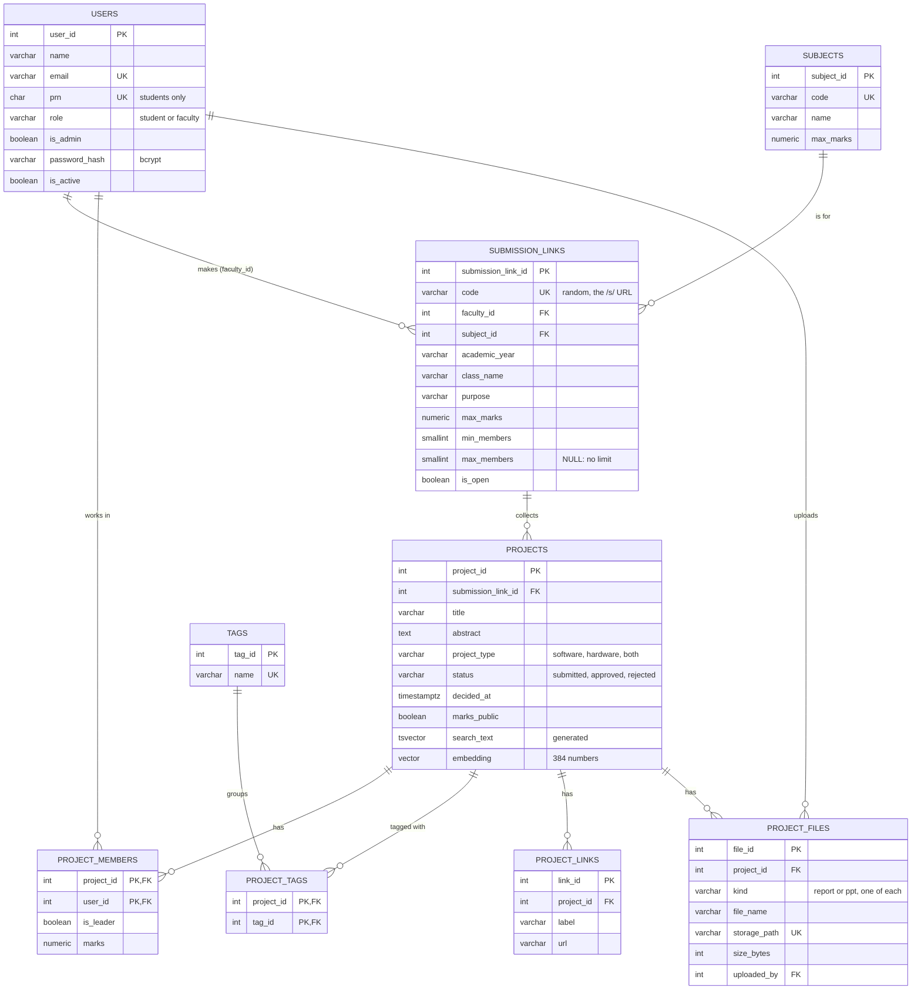

# PBL Tracker

One place for every PBL project at MIT-WPU: who was in the team, which subject and class
it was for, which faculty member approved it, what it was built with, its report,
presentation and links, and the marks each student got. A faculty member makes a
submission link for each class (subject, class, what the submission is for) and sends it
to the students. Every project submitted through that link counts towards that class's
submission; the faculty member approves or rejects each one, gives every student their
own marks, and downloads the class's marks as a spreadsheet. While a team fills in the
form, the closest past projects are shown **by meaning**, not just by matching words, so
repeated ideas get noticed.

DBMS PBL, 2026-27. PostgreSQL 17 with pgvector (hosted on Supabase), files in a
Backblaze B2 bucket, a FastAPI server with a React front end, psycopg 3, and the
all-MiniLM-L6-v2 sentence embedding model.

## The problem

Each semester a student does several PBLs, one per lab subject and sometimes one for a
theory subject too. Teams are anywhere from 2 to 5 people, every subject marks out of a
different total (33 for a lab, 5 for a theory mini project), and the reports and slides
end up scattered across WhatsApp groups and pen drives. Nobody can easily check whether
a "new" idea was done two years ago, and marks live in separate spreadsheets.

A shared folder can't fix this: it can only search file names, can't refuse 34 marks on
a subject out of 33, and can't tell that "cardiac risk estimation" and "heart disease
prediction" are the same project.

## Keyword search vs. meaning search

Real results from the sample data in this repository:

| Query | Keyword search finds | Meaning search finds |
|---|---|---|
| "heart disease" | Heart Disease Prediction System | Heart Disease Prediction System, Cardiac Risk Estimation from Patient Vitals |
| "Predict heart attack risk from patient health data" | nothing | Cardiac Risk Estimation (0.69), Heart Disease Prediction (0.62), Diabetes Risk Prediction (0.52) |
| "Book borrowing system for the department library" | nothing | College Library Management (0.56), Department Library Book Tracker (0.54) |

The cardiac project never uses the word "heart", so keyword search can't find it. In the
60 sample projects the database finds 3 near-duplicate pairs and 14 more similar pairs
across different years.

## What the app does

| Page | Who | What |
|---|---|---|
| Dashboard | everyone | Students: where each of their projects is (submitted, approved, graded), their own marks, status chart, popular stacks, recently approved projects. Faculty: submissions waiting for review with how close each is to a past project, open submission links, projects by subject, spread of team scores, projects not graded yet. Admin: totals, projects per year by status, projects per subject, what each faculty member still has to review, latest submissions |
| Search projects | everyone | Every approved project from every year, by name or by idea (keyword, meaning, or both merged with Reciprocal Rank Fusion), with subject, technology, type and year filters |
| Project | everyone | The report opens on the left; on the right the team, subject, year, the faculty member who approved it, the dates, technologies, links, presentation and abstract |
| Submission link (`/s/<code>`) | everyone | What the link is for (subject, class, faculty member, purpose), the class's approved projects, and, for a student whose team has no project here yet, the submit form: title, abstract, teammates, technologies, the report (PDF, required), and optionally the presentation, a GitHub link and a working demo link. The closest past projects show up next to the form |
| Trends | everyone | Most used technologies per year, software vs. hardware, ideas that keep coming back, faculty load |
| Submission links | faculty | Make a link (subject, class, what it is for, what each student is marked out of, how many students a team can have), copy it to send to the class, close it when the deadline passes. Each link's page lists every project that came in with each student's marks, and downloads them as a CSV file |
| Project, for its faculty member | faculty | Approve or reject with a note, then give each student their marks |
| People | admin | Add students and faculty, give someone a temporary password, switch an account off, make a faculty member an admin |
| Subjects | admin | Add subjects and set what each one is marked out of |
| Your account | everyone | Change your password |

Only MIT-WPU people can use it: every account has an `@mitwpu.edu.in` email, and
nothing opens without signing in. Students sign in with their PRN or college email,
faculty with their email. Passwords are checked inside PostgreSQL (bcrypt through
pgcrypto). Light and dark themes are in the sidebar.

Each student sees their own marks and the team score, which is the average of the team's
marks once every member has been graded. The faculty member who made the link and the
PBL coordinator see everyone's marks. The team can switch on "Show our team score to
everyone" on its project page; a student's own marks are never shown to the rest of the
class. A project still waiting for review, or rejected, is seen only by its team, its
faculty member and the coordinator. Approved projects are open to the whole site.

The team and its faculty member can replace the report, add, replace or remove the
presentation (PowerPoint or PDF), and add or remove links, up to 20 MB per file.

The app has two halves. `api/` is a small FastAPI server: every endpoint opens one
transaction and runs the SQL. `web/` is the React front end (Vite, TypeScript) that
calls it; `python -m api` serves both from one address once the front end is built.

## Database design

9 tables in 3NF, 6 views, 6 triggers, 18 functions (6 of them trigger functions).
Design notes, the normalisation walk-through and index choices are in
[docs/design.md](docs/design.md).



Students and faculty share one `users` table with a `role` column, so a project's team
(`project_members.user_id`) and the faculty member who made its link
(`submission_links.faculty_id`) both point at `users`. A project's subject, faculty member
and year are its link's, so `projects` only keeps `submission_link_id`. Marks belong to a
student in a team, so they sit on `project_members`; the team score is worked out by the
`team_marks` view, never stored. Tags cover the stack and anything else worth filtering on
(ESP32, Flask, OpenCV); whether a project is software, hardware or both is its own column.
The files themselves live in a Backblaze B2 bucket; `project_files` keeps the name, size,
who uploaded it and where it is stored.

### Rules the database enforces

| Rule | How |
|---|---|
| A team has as many students as its link allows: the faculty member sets the fewest and the most, or leaves it at any size | `team_size_range` CHECK; `check_member` trigger refuses one student too many; `submit_project()` checks the whole team; `check_submission_link` refuses sizes that a team already in the link doesn't fit |
| A student can be in any number of projects in a year | Nothing limits it, on purpose |
| A student has one live project per submission link (a rejected one doesn't count, so the team can try again) | `check_member` trigger, with an advisory lock so two submits at once can't both get in |
| Only students can be team members | `check_member` trigger |
| One leader per team | Partial unique index |
| A submission link belongs to a faculty user | `check_submission_link` trigger |
| A link's code is random and comes from the database, never from the app | `gen_random_bytes()` default, and `pbl_app` has no rights on the column |
| A closed link takes no new projects | `submit_project()` |
| Each student's marks can't be negative or more than the link's maximum, which starts as the subject's (33 for a lab, 5 for a theory mini project) | CHECK + `check_member` trigger |
| A link's maximum can't go below marks already given | `check_submission_link` trigger |
| Only approved projects can be marked | `check_member` trigger |
| The team score is the average of its members' marks, shown only once all of them have marks | `team_marks` view |
| Status is submitted, then approved or rejected once; the trigger records the date | CHECK + `check_project` trigger, and a CHECK that `decided_at` is set exactly when it was decided |
| Every account has an `@mitwpu.edu.in` email | `college_email` CHECK |
| A project is submitted with its report; one report (a PDF) and at most one presentation per project; the report can be replaced but not removed | `submit_project()`, unique `(project_id, kind)`, `reports_are_pdf` CHECK, `keep_report` trigger |
| Approving a near duplicate (similarity 0.70 or more) needs a review note | `check_near_duplicate` trigger, using pgvector |
| A link's academic year looks like `2026-27`, and 27 follows 26 | Two named CHECK constraints (regex, then arithmetic) |
| The same title can't be submitted twice through one link | Unique index on `(submission_link_id, lower(title))` |
| Links start with http:// or https://, once per project | CHECK + unique constraint |
| Files are up to 20 MB | CHECK on `size_bytes` |
| Tag names are unique ignoring case | Unique index on `lower(name)` |
| Students have a 10-digit PRN, faculty don't; only faculty can be admins | Two CHECK constraints on `users` |
| Deleting a project removes its members, tags, links and file records; a user still in a team can't be deleted | `ON DELETE CASCADE` from projects only |
| Editing a title or abstract throws away its old embedding | `clear_stale_embedding` trigger |
| Only bcrypt hashes are stored | `hash_password()` with pgcrypto |

### PostgreSQL features used

pgvector with an HNSW index for meaning search; full-text search on a generated
`tsvector` column with a GIN index; pgcrypto for bcrypt password hashing and random link
codes; advisory locks; stored
functions (`similar_projects`, `keyword_search`, `hybrid_search`, `submit_project`,
`sign_in`); triggers in PL/pgSQL; a login role with column-level privileges; JSONB and
arrays in the `project_cards` view; partial and expression indexes; `LATERAL` joins;
`FILTER` aggregates.

## Security

The app connects as `pbl_app`, a login that can read what the pages show and change
only what the app needs: a project's status, review note and whether its team score is
public, each student's marks, its links and files, a submission link's class, purpose,
maximum and whether it is open (never its code), subjects, and whether a user is
switched on or an admin. It can't read password hashes,
can't delete projects or users, and creates projects and users only through
`submit_project()` and `create_user()`, which check everything first. Which signed-in
person may do what (a student, the faculty member who owns the link, an admin) is checked by the
server before it runs anything. Details: [docs/security.md](docs/security.md).

No credentials are in this repository. They live in `.env`, which git ignores.

## Running it

You need Python 3.10+, Node.js 20+, and either a Supabase project or Docker.

```
python -m venv .venv
.venv\Scripts\activate            # macOS/Linux: source .venv/bin/activate
pip install -r requirements.txt   # about 100 MB, mostly onnxruntime
copy .env.example .env            # macOS/Linux: cp .env.example .env
cd web && npm install && npm run build && cd ..
```

### Database on Supabase

1. Create a free project at [supabase.com](https://supabase.com). Note the database password.
2. Click **Connect**, choose **Session pooler**, and copy the URI. It works on IPv4 networks,
   which most college Wi-Fi is.
3. In `.env`, set `ADMIN_DATABASE_URL` to that URI (user `postgres.<project-ref>`), choose a
   long random `PBL_APP_PASSWORD`, and set `DATABASE_URL` to the same URI with the user
   `pbl_app.<project-ref>` and that password. Keep `?sslmode=require` on both. Choose a
   `SEED_PASSWORD` too: every sample user gets it.
4. Build and fill the database:

```
python -m scripts.setup_db
python -m scripts.load_data
python -m scripts.embed_projects
```

`setup_db` runs every file in `sql/` in one transaction (so a failure leaves nothing half
built), creates the `pbl_app` login, and sets its password from a hash made on your
machine. `--reset` rebuilds from scratch. `load_data` hashes a password for each sample
user, which takes about 10 seconds.

### Reports and presentations (Backblaze B2)

The free plan has 10 GB, much more than Supabase Storage's 1 GB.

1. Create a free account at [backblaze.com](https://www.backblaze.com/cloud-storage).
2. **Buckets > Create a Bucket**: any name that isn't taken (bucket names are shared
   across all of B2), files **Private**. Note the **Endpoint** shown on the bucket.
3. **Application Keys > Add a New Application Key**: allow access to this bucket only,
   Read and Write. The application key is shown once.
4. In `.env`, set `B2_ENDPOINT`, `B2_BUCKET`, `B2_KEY_ID` and `B2_APPLICATION_KEY`.

The browser never talks to B2: files go through the server, which checks who is
uploading and what kind of file it is. With these settings empty, files are kept in
the `uploads/` folder instead, which is fine for working on a laptop.

### Database on your laptop (Docker)

```
docker compose up -d
```

Put `POSTGRES_PASSWORD` in `.env` and point both URLs at `127.0.0.1:5434` (see
`.env.example`), then run the same three scripts.

### The app

```
python -m api                     # http://127.0.0.1:8000
```

While working on the front end, also run `npm run dev` in `web/` and open
http://127.0.0.1:5173: it reloads on every save and passes `/api` calls to the Python
server. After editing Python code, restart `python -m api`.

Sign in with one of the sample users and the `SEED_PASSWORD` from your `.env`:

| Role | Sign in as | Shows |
|---|---|---|
| Student | `1262241783` (Rohan Deogaonkar) | A submission very close to an earlier project, waiting for review, and an approved project |
| Student | `1262241766` (Krishna Bhand) | No project this year: open a submission link to submit one |
| Faculty | `srao@mitwpu.edu.in` (Prof. S. Rao) | The ML-PBL submission link for TY ECE Div B, with Rohan's submission waiting for review |
| Faculty | `riyer@mitwpu.edu.in` (Prof. R. Iyer) | Rohan's approved project, students not graded yet |
| Admin | `nshaikh@mitwpu.edu.in` (Dr. N. Shaikh, PBL coordinator) | Everything, plus People and Subjects |

**Demo account switcher.** With `DEMO_SWITCHER=on` in `.env`, the sign-in page lists
these five users and the sidebar gets a "Switch account" menu. It signs in through the
same `sign_in()` with `SEED_PASSWORD`, so switched-off accounts and changed passwords
still apply. With it on, anyone who can open the app can become the admin: keep it off
anywhere other people can reach the app.

A sign-in lasts until you sign out, go 30 minutes without a click, or the server
restarts. The first meaning search waits for the model, which takes about 10 seconds to
load (the server starts loading it in the background at startup); after that a search
takes milliseconds.

## Tests

```
pytest
```

87 tests: the rules, what `pbl_app` may and may not do, sign-in and passwords (50
database tests), and the web server's sessions, every page for every role, submission
links, submitting with a report, approving and grading each student, the marks export,
who sees a project and its marks, links and files (37 API tests). The
database tests run inside a transaction that is rolled back, so the data is untouched;
the API tests that add or change anything put it back. GitHub Actions runs the database tests every night at 11:30 pm IST
against a fresh pgvector container.

## Viva demo

```
psql "<ADMIN_DATABASE_URL>" -f sql/demo.sql
```

Twenty-one steps: submission links, each rule failing with its own error message,
each student's marks and the team score, keyword vs. meaning search, the approval rule,
`pbl_app`'s privileges, joins, views and the index plans. It
all runs in a transaction that is rolled back, so it can be repeated. Expected output is
in [docs/demo-output.txt](docs/demo-output.txt); the order to show things in and likely
viva questions are in [docs/viva.md](docs/viva.md).

## Repository layout

```
sql/          01-07 build the database in order; demo.sql is the viva script
scripts/      setup_db.py, load_data.py, embed_projects.py, sample_reports.py
finder/       shared Python: settings, database access, file storage, embeddings
api/          the FastAPI server: sessions, and the routes for each area
web/          the React front end (src/pages has one file per page)
data/         sample faculty, students and projects (all made up)
tests/        database rules, privileges, sign-in, the API
docs/         design, security, viva notes, demo output
```

## Sample data

The 60 projects, 126 students and 8 faculty members in `data/` are invented for testing.
The topics are typical of engineering PBLs, and every name, PRN and email is made up,
apart from the demo student, who carries a team member's name (Rohan Deogaonkar) with a
made-up PRN and email. Each sample project has a one-page sample report. More in
[data/README.md](data/README.md).

## Team

| Member | Area | Also owns |
|---|---|---|
| Rohan | Database: tables, constraints, normalisation, ER diagram, triggers, views, functions, privileges (`sql/`, `scripts/`) | Testing (`tests/`) |
| Om | Back end: the FastAPI server, sessions, search, embeddings and file storage (`api/`, `finder/`) | Project report |
| Krishna | Front end: the React app (`web/`) | Documentation (README, `docs/`) |
