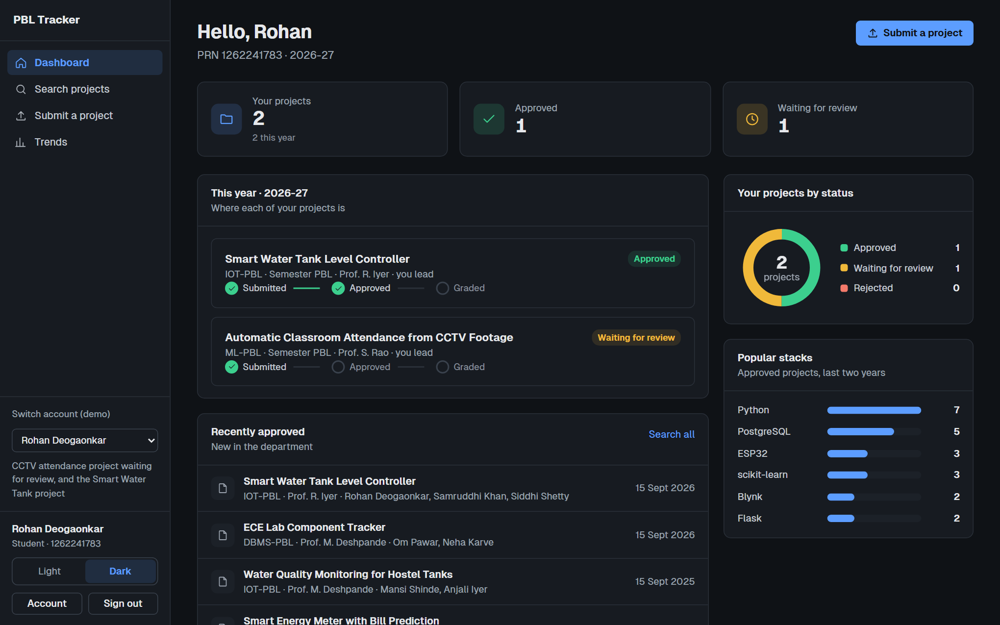
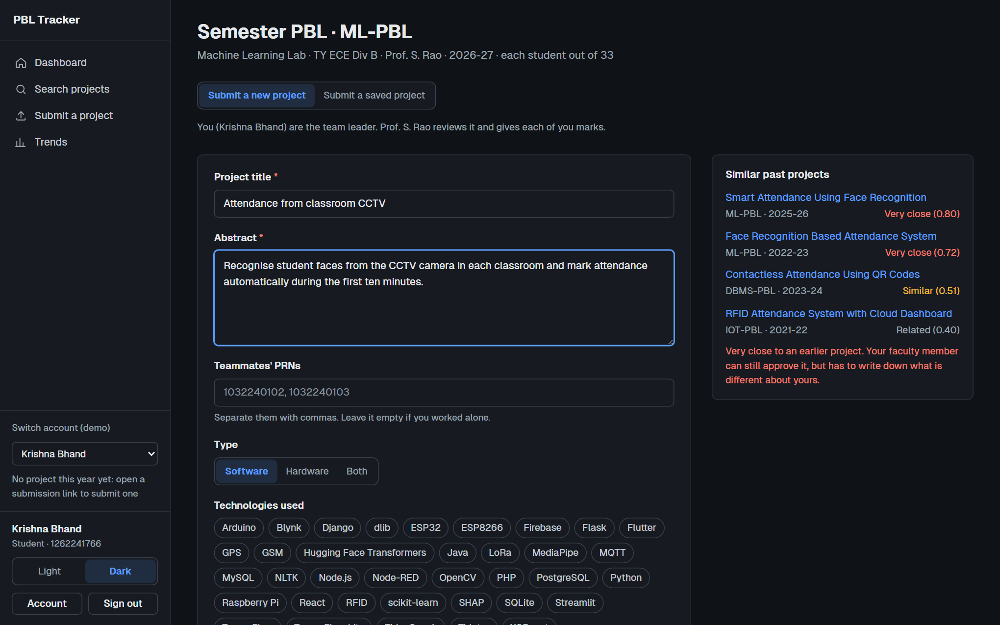
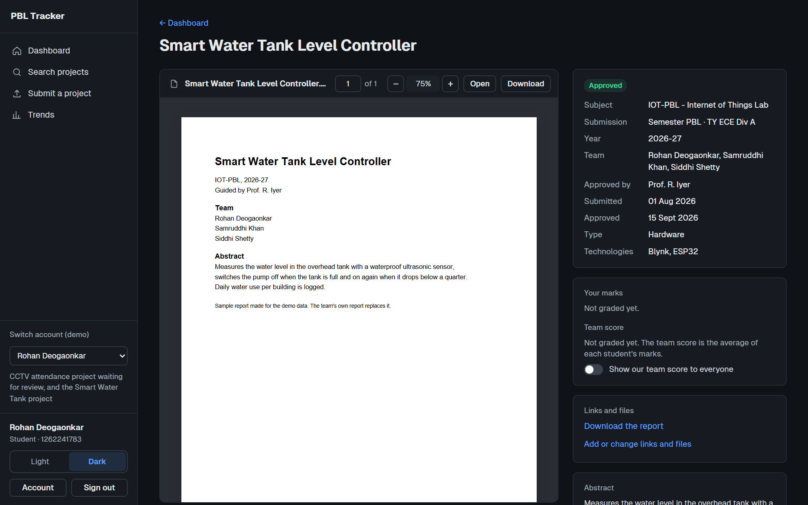
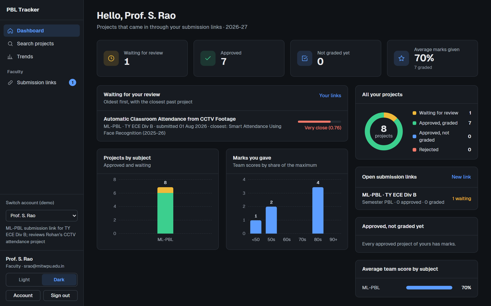
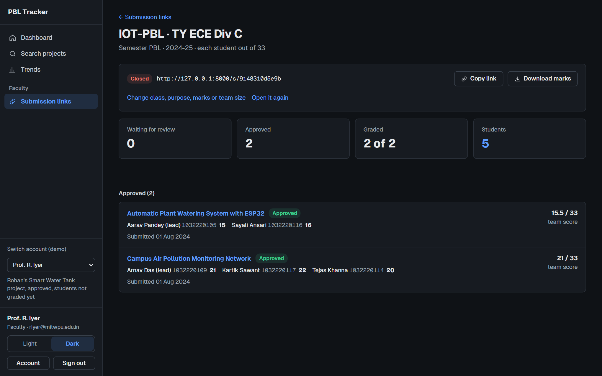
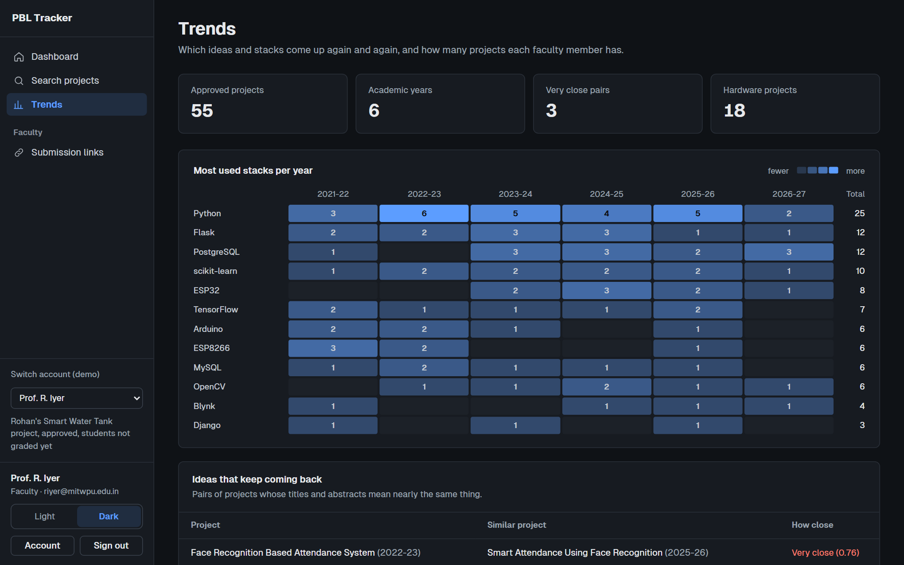
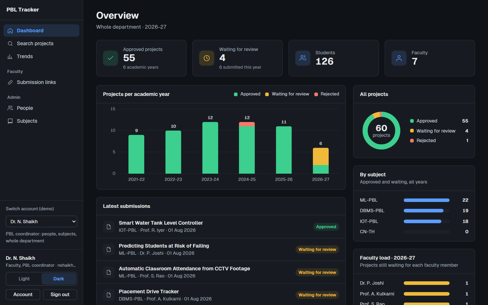
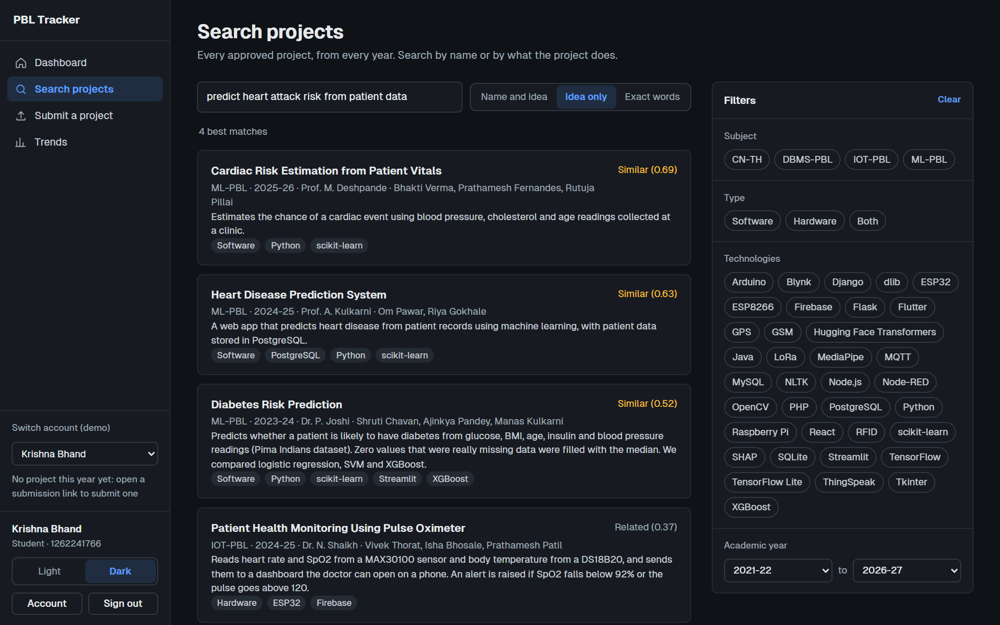
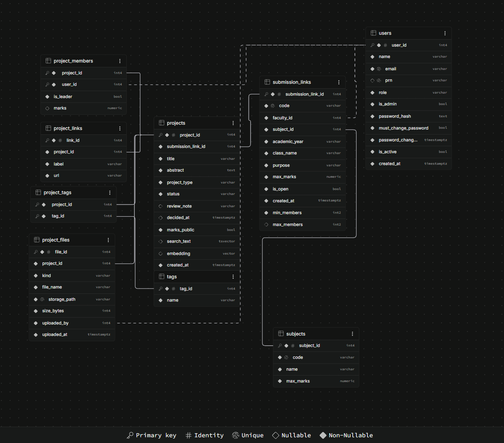

# PBL Tracker

Every PBL project at MIT-WPU in one PostgreSQL database. Faculty collect a class's
projects through one submission link, approve them and mark each student. Anyone can
search past projects by what they do, not only by their title.

[](https://github.com/rohanbeingsocial/PBL-Tracker/actions/workflows/database-tests.yml)




DBMS PBL 2026-27, TY ECE, MIT-WPU.

## The problem

A student does several PBLs each semester, one per lab subject. Every subject marks out
of a different total (33 for a lab, 5 for a theory mini project). Reports end up in
WhatsApp groups and pen drives, marks sit in separate spreadsheets, and nobody can easily
check whether a "new" idea was done two years ago.

A shared folder can't fix this. It can't refuse 34 marks out of 33, can't stop a student
from submitting twice, and can't tell that "cardiac risk estimation" and "heart disease
prediction" are the same project. A database can.

## How it works

1. A faculty member makes a **submission link** for one class: subject, class, purpose,
   what each student is marked out of and how many students a team can have. They send
   the link to the class.
2. Students sign in with their college account, open the link and submit the title,
   abstract, team, stack and report (PDF). Similar past projects show up as they type.
3. The faculty member approves or rejects each project, gives **each student their own
   marks**, and downloads the class's marks as a CSV file.
4. Approved projects join the searchable record for every year after.

| Role | What they can do |
|---|---|
| Student | Submit through a link, see their own marks and the team score, search every approved project |
| Faculty | Make and close submission links, approve or reject, mark each student, export marks |
| Coordinator (admin) | See the whole department, add people and subjects, give temporary passwords |

## Screenshots

<table>
  <tr>
    <td width="50%"><br><b>Submitting through a link.</b> Past projects close to the new idea are flagged while the team types.</td>
    <td width="50%"><br><b>Project page.</b> The report opens in the page, with the team, subject and dates beside it.</td>
  </tr>
  <tr>
    <td width="50%"><br><b>Faculty dashboard.</b> Submissions waiting for review, each with its closest past project.</td>
    <td width="50%"><br><b>One class's marks.</b> Each student's marks and the team score. Download marks gives a CSV.</td>
  </tr>
  <tr>
    <td width="50%"><br><b>Trends.</b> Stacks used each year, and ideas that keep coming back.</td>
    <td width="50%"><br><b>Coordinator overview.</b> Projects per year, per subject and per faculty member.</td>
  </tr>
</table>

## Keyword search vs. meaning search

| Query | Keyword search finds | Meaning search finds |
|---|---|---|
| "heart disease" | Heart Disease Prediction System | Heart Disease Prediction System, Cardiac Risk Estimation from Patient Vitals |
| "Predict heart attack risk from patient health data" | nothing | Cardiac Risk Estimation (0.69), Heart Disease Prediction (0.62), Diabetes Risk Prediction (0.52) |
| "Book borrowing system for the department library" | nothing | College Library Management (0.56), Department Library Book Tracker (0.54) |



The cardiac project never uses the word "heart", so keyword search misses it. The
all-MiniLM-L6-v2 model turns each title and abstract into 384 numbers, stored in a
pgvector column; projects that mean the same thing get nearby numbers. "Name and idea"
merges both rankings with Reciprocal Rank Fusion. In the 60 sample projects the database
finds 3 near-duplicate pairs and 14 more similar pairs across different years.

## Database design



*ER diagram of schema `pbl`, taken from Supabase's Schema Visualizer.*

| Object | Count | Names |
|---|---|---|
| Tables | 9, in 3NF | `users`, `subjects`, `submission_links`, `projects`, `project_members`, `project_tags`, `tags`, `project_links`, `project_files` |
| Views | 6 | `project_cards`, `team_marks`, `link_progress`, `review_queue`, `repeated_ideas`, `tag_trends` |
| Triggers | 6 | `check_submission_link`, `check_project`, `check_member`, `check_near_duplicate`, `clear_stale_embedding`, `keep_report` |
| Functions | 18 | `submit_project`, `keyword_search`, `similar_projects`, `hybrid_search`, `sign_in` and 13 more |
| Indexes | 11 | GIN for full text, HNSW for vectors, foreign keys, partial and expression indexes |

Students and faculty share one `users` table. A project comes in through one submission
link, which fixes its subject, faculty member and year. Students and projects are
many-to-many through `project_members`, which also holds each student's marks; projects
and tags through `project_tags`. The team score is never stored: the `team_marks` view
works it out.

Some of the rules the database enforces (all of them are in
[docs/design.md](docs/design.md#rules-the-database-enforces)):

| Rule | How |
|---|---|
| Marks from 0 to the link's maximum, only on approved projects | CHECK + `check_member` trigger |
| One live project per student per submission link | `check_member` trigger, with an advisory lock |
| Team size within the link's limits | `team_size_range` CHECK, `check_member`, `submit_project()` |
| Submitted, then approved or rejected once, with the date recorded | `check_project` trigger + CHECK on `decided_at` |
| Approving a near duplicate (similarity 0.70 or more) needs a note | `check_near_duplicate` trigger, using pgvector |
| A project and its team, tags, links and files are saved together or not at all | `submit_project()`, one transaction |
| One report per project, always a PDF, replaceable but not removable | unique `(project_id, kind)`, `reports_are_pdf` CHECK, `keep_report` trigger |
| Only `@mitwpu.edu.in` accounts | `college_email` CHECK |
| Link codes are random and never chosen by the app | `gen_random_bytes()` default, no grant on the column |

**PostgreSQL features used:** pgvector with an HNSW index, full-text search on a generated
`tsvector` column with a GIN index, pgcrypto for bcrypt and random codes, PL/pgSQL
triggers and stored functions, advisory locks, column-level privileges, JSONB and arrays
in views, partial and expression indexes, `LATERAL` joins and `FILTER` aggregates.

The normalisation walk-through, design decisions and index choices are in
[docs/design.md](docs/design.md).

## Security

- The app logs in as `pbl_app`. It can't read password hashes, can't delete projects or
  users, and can change only the columns the pages need.
- Passwords are bcrypt hashes (pgcrypto, cost 11), checked inside the database by
  `sign_in()`. The app never sees a hash.
- The tables live in their own schema, `pbl`, so Supabase's public REST API can't reach them.
- No credentials are in this repository. They live in `.env`, which git ignores;
  `.env.example` lists the names.

Details: [docs/security.md](docs/security.md).

## Tech stack

| Part | Uses |
|---|---|
| Database | PostgreSQL 17 with pgvector and pgcrypto, hosted on Supabase |
| Files | A private Backblaze B2 bucket for reports and presentations |
| Server | Python 3.12, FastAPI, psycopg 3 |
| Front end | React 19, TypeScript, Vite, pdf.js |
| Meaning search | all-MiniLM-L6-v2, run with onnxruntime |
| Hosting | Render |

## Running it

You need Python 3.10+, Node.js 20+, and either a Supabase project or Docker.

```bash
python -m venv .venv
.venv\Scripts\activate              # macOS/Linux: source .venv/bin/activate
pip install -r requirements.txt
copy .env.example .env              # macOS/Linux: cp; then fill it in (below)
cd web && npm install && npm run build && cd ..

python -m scripts.setup_db          # builds the schema in one transaction
python -m scripts.load_data         # sample users, projects and reports
python -m scripts.embed_projects    # embeddings for meaning search
python -m api                       # http://127.0.0.1:8000
```

<details>
<summary><b>Database on Supabase</b></summary>

1. Create a free project at [supabase.com](https://supabase.com) and note the database password.
2. Click **Connect**, choose **Session pooler** (it works on IPv4, which most college Wi-Fi is) and copy the URI.
3. In `.env`, set `ADMIN_DATABASE_URL` to that URI (user `postgres.<project-ref>`). Choose a
   long random `PBL_APP_PASSWORD`, and set `DATABASE_URL` to the same URI with the user
   `pbl_app.<project-ref>` and that password. Keep `?sslmode=require` on both. Choose a
   `SEED_PASSWORD` too: every sample user gets it.
4. Run the three scripts above. `--reset` on `setup_db` rebuilds from scratch.

`setup_db` creates the `pbl_app` login and sets its password from a hash made on your
machine, so the plain password never reaches the server.
</details>

<details>
<summary><b>Reports and presentations on Backblaze B2</b></summary>

1. Create a free account at [backblaze.com](https://www.backblaze.com/cloud-storage) (10 GB free).
2. Create a bucket with files **Private** and note its **Endpoint**.
3. Add an application key for this bucket only, with Read and Write.
4. In `.env`, set `B2_ENDPOINT`, `B2_BUCKET`, `B2_KEY_ID` and `B2_APPLICATION_KEY`.

The browser never talks to B2: files go through the server, which checks who is uploading
and what kind of file it is. With these settings empty, files go to `uploads/` instead.
</details>

<details>
<summary><b>Database on your laptop (Docker)</b></summary>

```bash
docker compose up -d
```

Put `POSTGRES_PASSWORD` in `.env`, point both URLs at `127.0.0.1:5434` (see
`.env.example`) and run the same three scripts.
</details>

<details>
<summary><b>Sample logins</b></summary>

All use the `SEED_PASSWORD` from your `.env`.

| Role | Sign in as | Shows |
|---|---|---|
| Student | `1262241783` (Rohan Deogaonkar) | A submission very close to an earlier project, waiting for review, and an approved project |
| Student | `1262241766` (Krishna Bhand) | No project this year: open a submission link to submit one |
| Student | `1262241700` (Om Nemade) | No project in the sample data yet |
| Faculty | `srao@mitwpu.edu.in` (Prof. S. Rao) | The ML-PBL link for TY ECE Div B, with Rohan's submission waiting |
| Faculty | `riyer@mitwpu.edu.in` (Prof. R. Iyer) | Rohan's approved project, students not graded yet |
| Admin | `admin@mitwpu.edu.in` (PBL coordinator) | Everything, plus People and Subjects |

With `DEMO_SWITCHER=on`, the sign-in page lists these users and the sidebar gets a
"Switch account" menu. Anyone who can open the app can then become any of them, the admin
included, so use it only with sample data.
</details>

While working on the front end, run `npm run dev` in `web/` as well and open
http://127.0.0.1:5173. It reloads on every save and passes `/api` calls to the Python server.

## Deployment

The app runs on Render, the database on Supabase and the files on Backblaze B2.

| Render setting | Value |
|---|---|
| Build command | `pip install -r requirements.txt && cd web && npm ci && npm run build` |
| Start command | `uvicorn api.app:app --host 0.0.0.0 --port $PORT --proxy-headers --forwarded-allow-ips='*'` |
| Environment | `PYTHON_VERSION=3.12.6`, `DATABASE_URL` (the `pbl_app` login), `B2_ENDPOINT`, `B2_BUCKET`, `B2_KEY_ID`, `B2_APPLICATION_KEY`, `SEED_PASSWORD`, `DEMO_SWITCHER` |

The owner login (`ADMIN_DATABASE_URL`) is never set on Render: the server only uses
`pbl_app`. `--proxy-headers` lets the server see Render's HTTPS, so the session cookie is
sent as `Secure`. The server peaks at about 230 MB, inside the free plan's 512 MB.

## Tests

```bash
pytest                                                       # 92 tests
E2E_URL=http://127.0.0.1:8000 pytest tests/test_browser.py   # 23 browser tests
```

- 53 database tests: the rules, what `pbl_app` may and may not do, sign-in and passwords.
  They run inside a transaction that is rolled back.
- 39 API tests: sessions, every page for every role, submitting, approving, marking and
  the marks export. Anything they add is removed again.
- 23 browser tests (Playwright) click through every page as a student, a faculty member
  and the admin.

GitHub Actions runs the database tests every night at 11:30 pm IST on a fresh pgvector
container.

## Viva demo

```bash
psql "<ADMIN_DATABASE_URL>" -f sql/demo.sql
```

21 steps: submission links, every rule failing with its own message, marks and the team
score, keyword vs. meaning search, `pbl_app`'s privileges, joins, views and index plans.
It runs in one transaction that is rolled back, so it can be repeated. Expected output:
[docs/demo-output.txt](docs/demo-output.txt). Demo order and likely questions:
[docs/viva.md](docs/viva.md).

## Repository layout

```
sql/          01-07 build the database in order; demo.sql is the viva script
scripts/      setup_db.py, load_data.py, embed_projects.py, sample_reports.py
finder/       shared Python: settings, database access, file storage, embeddings
api/          the FastAPI server: sessions and the routes for each area
web/          the React front end (src/pages has one file per page)
data/         sample faculty, students and projects
tests/        database rules, privileges, sign-in, the API, the browser
docs/         design, security, viva notes, demo output, screenshots
```

The 60 projects, 127 students and 8 faculty members in `data/` are made up for testing,
apart from the three demo students, who are the team. Each project has a one-page sample
report. More in [data/README.md](data/README.md).

## Team

| Member | Area | Also owns |
|---|---|---|
| Rohan | Database: tables, constraints, normalisation, ER diagram, triggers, views, functions, privileges (`sql/`, `scripts/`) | Testing (`tests/`) |
| Om | Back end: the FastAPI server, sessions, search, embeddings and file storage (`api/`, `finder/`) | Project report |
| Krishna | Front end: the React app (`web/`) | Documentation (README, `docs/`) |
